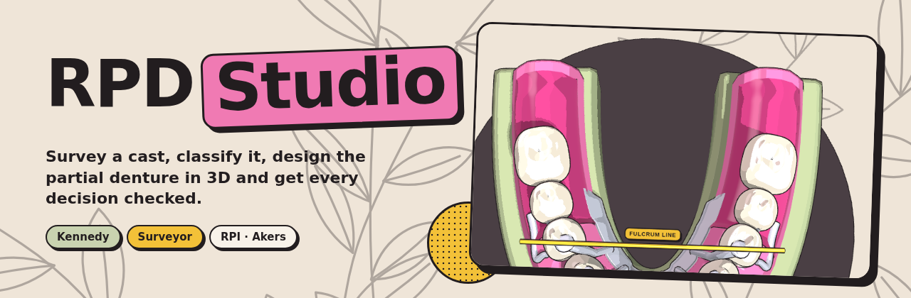
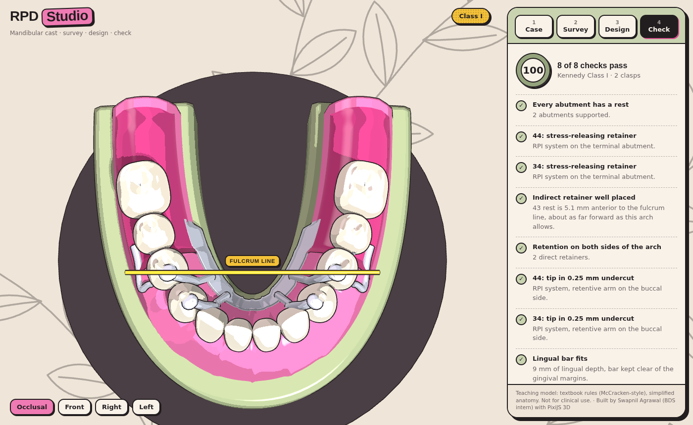
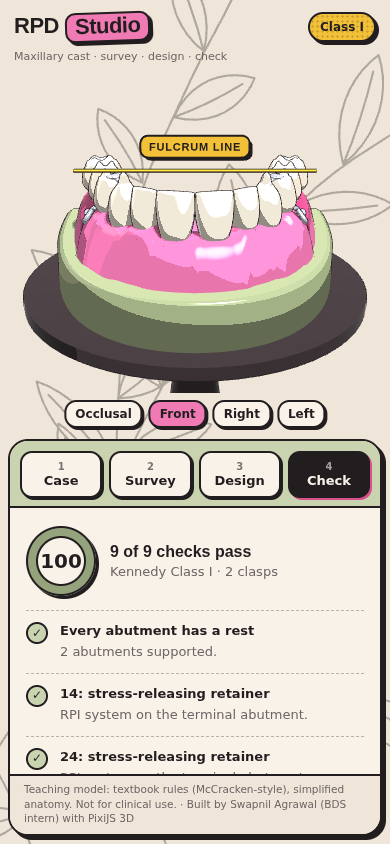
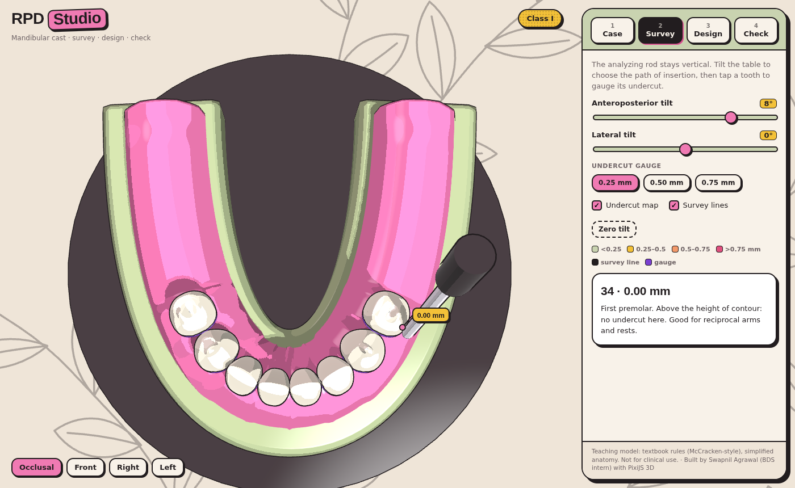
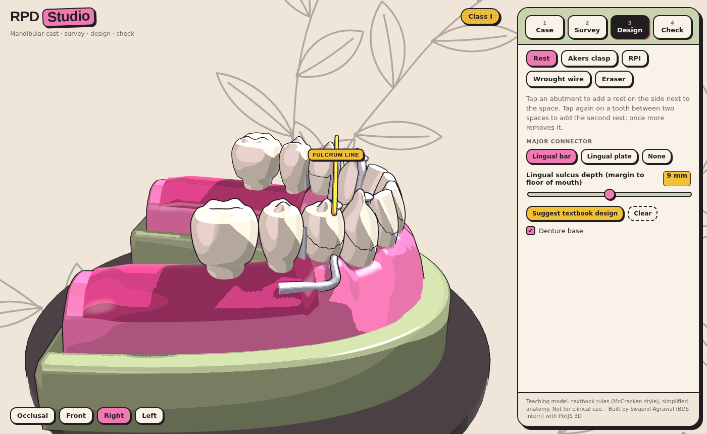
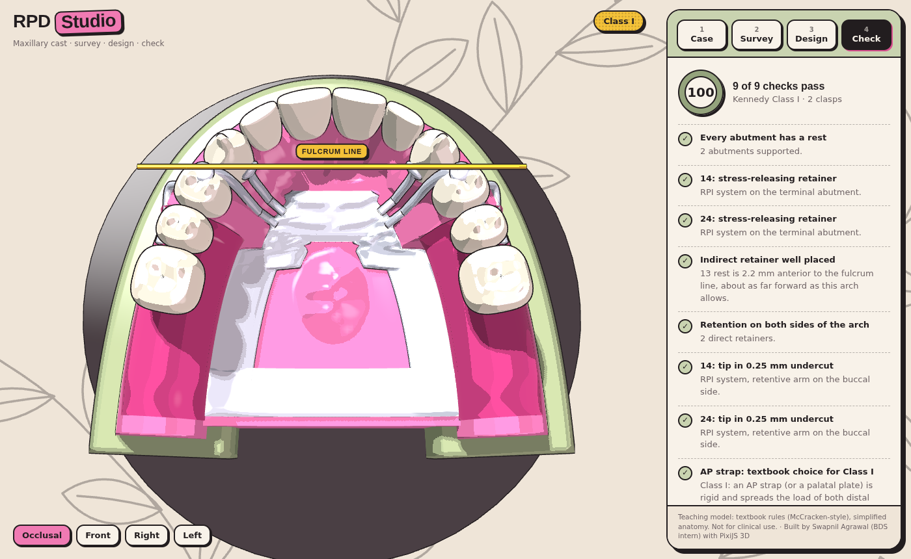
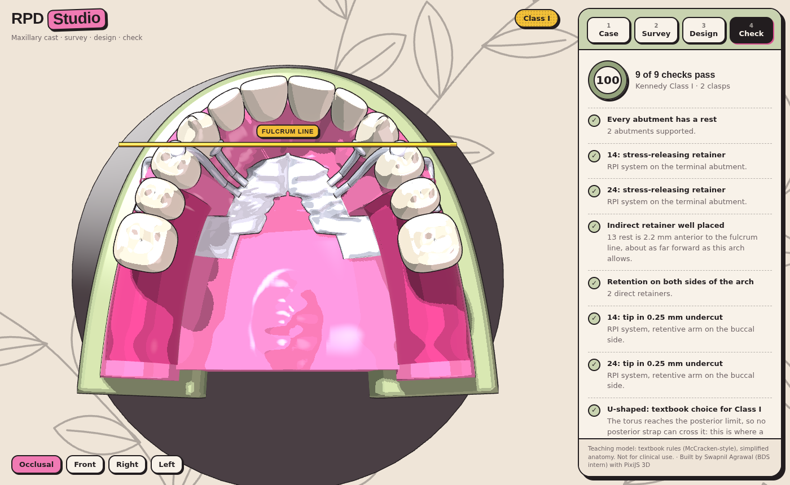
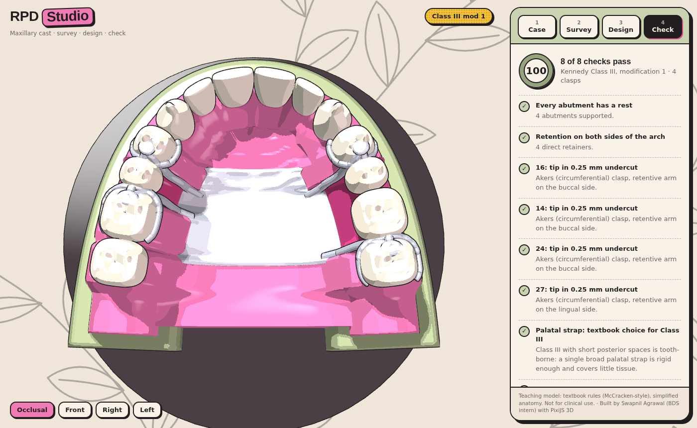
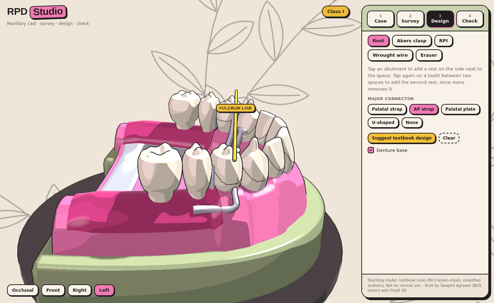

<p align="center"></p>

<p align="center">
  
  
  
  
</p>

<p align="center"><b>A 3D lab for designing removable partial dentures.</b><br>
Survey a mandibular or maxillary cast, let it classify itself, place rests, clasps and a major connector, and watch every decision get checked against the textbook.</p>

---

## 🦷 The four steps

| | Step | What you do |
|---|---|---|
| **1** | **Case** | Choose the arch (mandibular or maxillary), pick a Kennedy preset or tap teeth to extract them. Class, modifications and Applegate notes update live. On the maxilla, add a palatal torus. |
| **2** | **Survey** | Tilt the table, keep the rod vertical. Height of contour, undercut map and gauge lines redraw on every tooth. Tap to measure. |
| **3** | **Design** | Rests, Akers, RPI, wrought-wire clasps. Lingual bar or plate below; palatal strap, AP strap, palatal plate or U-shaped connector above. Saddles and teeth fill every span. |
| **4** | **Check** | A scored list of design rules, from rest placement to indirect retention ahead of the fulcrum line. |

## 📸 Screens

<table>
<tr>
<td width="60%"><br><sub><b>Design</b> · Class I framework with RPI clasps, lingual bar and the fulcrum line</sub></td>
<td width="40%" rowspan="2"><br><sub><b>Check</b> · works on phones too</sub></td>
</tr>
<tr>
<td><br><sub><b>Survey</b> · 8° anteroposterior tilt, undercut map and gauge line</sub></td>
</tr>
<tr>
<td colspan="2"><br><sub><b>Side view</b> · saddle, replacement teeth and I-bar on the distal-extension side</sub></td>
</tr>
</table>

### 🔼 Maxillary arch

<table>
<tr>
<td width="50%"><br><sub><b>AP strap</b> · Class I with a mid-palatal torus: the strap rings round it</sub></td>
<td width="50%"><br><sub><b>U-shaped</b> · only when the torus reaches the posterior limit</sub></td>
</tr>
<tr>
<td><br><sub><b>Palatal strap</b> · Class III mod 1, short tooth-borne spaces</sub></td>
<td><br><sub><b>Side view</b> · maxillary cast teeth-up on the surveyor table</sub></td>
</tr>
</table>

## ✨ What's inside

- **Kennedy + Applegate** classification, including rule 4 (unreplaced second molars), rule 7 and rule 8 (Class IV)
- **Surveyor** with ±15° anteroposterior and lateral tilt; undercut bands at **<0.25 / 0.25–0.5 / 0.5–0.75 / >0.75 mm**
- **Clasps that respect the survey**: tips sit at the undercut their alloy needs, so a bad path of insertion fails the check
- **Both arches**: a procedural mandibular cast and a maxillary cast with palate, rugae, incisive papilla and an optional palatal torus (mid-palate or reaching the posterior limit); FDI numbering follows the arch
- **Framework parts**: occlusal and incisal rests, Akers, RPI, wrought-wire combination clasps, lingual bar or plate (chosen from sulcus depth), palatal strap, AP strap, palatal plate or U-shaped connector (chosen from Kennedy class, span and torus), saddles and replacement teeth
- **Palatal checks**: textbook connector choice per class, strap width, and metal crossing a torus
- **Suggest textbook design** for any case, then break it and see what fails
- **Comic toon look**: ink outlines, pink / mustard / sage palette, cream paper

## 🚀 Run it

```bash
npm install
npm run dev      # local
npm run build    # static site in dist/ (Vercel / Netlify ready)
```

## 🗂️ Code map

| File | What it holds |
|---|---|
| `src/kennedy.js` | Kennedy + Applegate logic, presets |
| `src/anatomy.js` | Procedural mandibular and maxillary casts, 14 teeth, gingiva, palate and torus, base |
| `src/survey.js` | Height of contour, undercut depth map, gauge lines |
| `src/design.js` | Framework builder, lingual and palatal major connectors, design rules, textbook suggestion |
| `src/main.js` | PixiJS 3D scene, toon materials, outline pass, UI |

## ⚠️ Disclaimer

Teaching model. Anatomy is simplified and the rules follow common textbook guidance; check them against your faculty's protocol. **Not for clinical use.**

> 🩺 **Maxillary clinical rules pending review by Swapnil Agrawal (BDS intern).** The palatal connector choices, strap widths and torus rules are new in this version and are still being checked against the textbook.

<p align="center"><sub>Built by <b>Swapnil Agrawal (BDS intern)</b> · Pacific Dental College & Hospital, Udaipur</sub></p>
